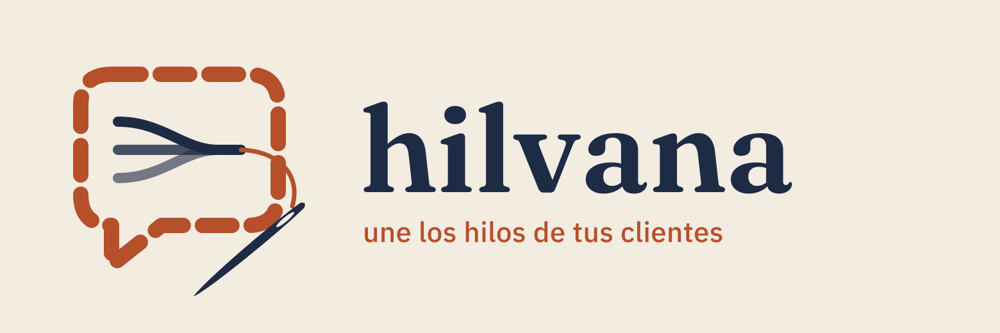
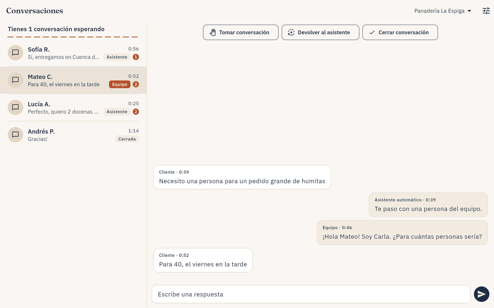
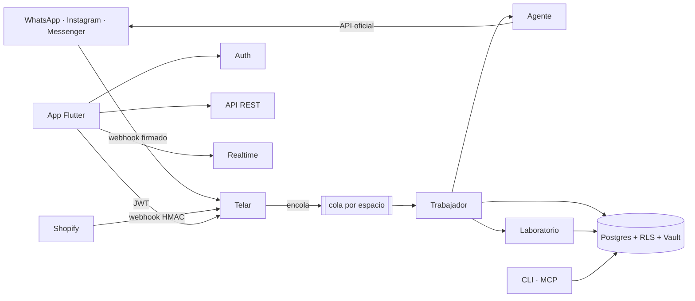
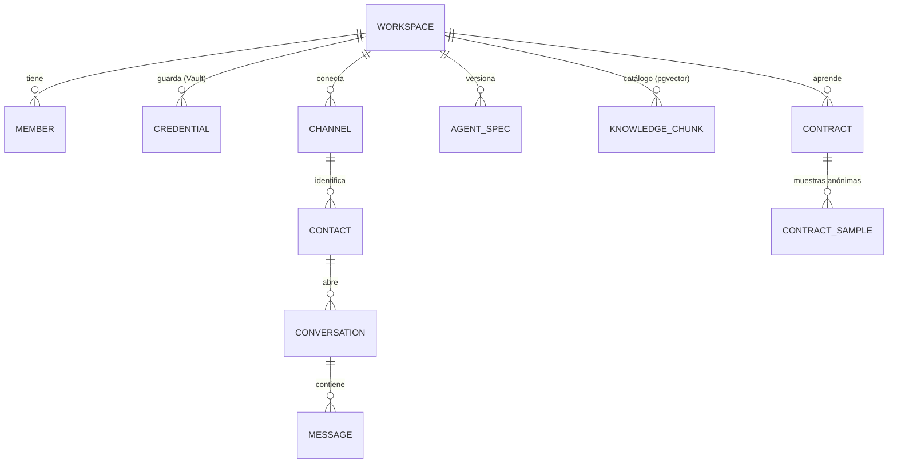

# Hilvana



**Une los hilos de tus clientes.** Base abierta y local primero para que programadores y agencias armen
su propia plataforma de atención por WhatsApp, Instagram, Messenger y Shopify: conectores oficiales,
claves por cliente en una bóveda, aislamiento total entre negocios, un agente que se configura
conversando, un laboratorio que detecta cambios en los webhooks, app Flutter, CLI y despliegue en
Google Cloud.

[](https://github.com/DiegoFranciscoG/hilvana/actions/workflows/ci.yml)
   
 [](LICENSE)

**Demo:** local, con datos ficticios: `deno task cli up` (o `docker compose up --build` tras `deno task cli init`)
y abre http://localhost:8000. **Usuario de prueba:** `demo@hilvana.test`; la contraseña se genera al azar
en `.env` (`DEMO_PASSWORD`). No hay demo pública: publicarla exige cuenta de Meta y de facturación en Google Cloud.



## Problema que resuelve

Cada equipo que arma atención por WhatsApp, Instagram y Messenger empieza de cero: webhooks con firmas,
ventanas de 24 horas y plantillas, claves de API de cada cliente mezcladas en variables de entorno,
datos de un negocio que se cruzan con los de otro, cambios de formato de Meta que se descubren tarde y
apps móviles por hacer. Hilvana resuelve esa plomería una vez, corre completo en una computadora y deja
que una agencia construya su plataforma en semanas.

## Funcionalidades

- **Telar (pasarela)**: webhooks de WhatsApp, Messenger, Instagram y Shopify con firma HMAC verificada
  sobre el cuerpo crudo, respuesta 200 inmediata y cola durable por negocio (pgmq).
- **Aislamiento por espacio**: RLS en todas las tablas, rol del Telar sin `BYPASSRLS` que solo ve el
  espacio fijado en cada transacción, claves en Supabase Vault y límites por espacio (mensajes por
  minuto, tokens de IA por día, gasto máximo).
- **Idempotencia y ventanas**: un webhook repetido nunca genera dos respuestas; fuera de las 24 h no sale
  texto libre (solo plantillas o la etiqueta Human Agent cuando corresponde).
- **Agente configurado conversando**: entrevista pregunta a pregunta que produce una especificación
  validada; respuestas con controles deterministas que impiden inventar precios o productos y resisten
  la inyección de instrucciones. Se presenta como asistente automático y deriva a una persona.
- **Laboratorio de contratos**: captura el tráfico propio, lo anonimiza antes de guardar, infiere el
  esquema JSON de cada evento, avisa con un diff legible cuando Meta cambia algo, reproduce muestras en
  local y genera tipos TypeScript y Dart.
- **App Flutter** (iOS, Android, web, Linux): bandeja en tiempo real, responder, tomar y devolver
  conversaciones, avisos con FCM y eliminación de cuenta dentro de la app.
- **CLI `hilvana`**, **Agent Skill** y **servidor MCP** de solo lectura por defecto.
- **Google Cloud**: Cloud Run, Secret Manager, Cloud Build y Artifact Registry con un plan que se
  muestra y se confirma antes de ejecutar.

## Arquitectura



Detalle, flujo de un mensaje y decisiones: [docs/arquitectura.md](docs/arquitectura.md).

## Stack y por qué

| Capa | Tecnología | Motivo |
|---|---|---|
| Base, Auth, tiempo real, colas y secretos | Supabase (Postgres 17, RLS, Vault, pgmq, pgvector, Realtime) | Todo en un proyecto y completo en local; colas y secretos dentro de la misma transacción. |
| Pasarela, trabajador, CLI y MCP | Deno 2.9 + Hono 4.13 | Permisos explícitos (red acotada a hosts concretos), TypeScript sin compilación, binario único con `deno compile`. |
| App | Flutter 3.50 + Dart 3.14 | Una base de código para iOS, Android, web y Linux con funcionalidad nativa. |
| Avisos | Firebase Cloud Messaging | Gratuito; en iOS usa APNs. |
| Nube | Cloud Run, Secret Manager, Cloud Build, Artifact Registry | Escala a cero y capa gratuita mensual. |
| Entorno | Nix flake + Docker Compose | Mismo entorno en cualquier Linux; `docker compose up --build` en cualquier sistema. |
| Agentes de desarrollo | Agent Skills + MCP | Operar Hilvana desde un agente sin exponer secretos. |

Versiones exactas y fuentes: [docs/verificacion.md](docs/verificacion.md) y [docs/investigacion.md](docs/investigacion.md).

## Modelo de datos



Todas las tablas, restricciones y su fuente: [docs/modelo-datos.md](docs/modelo-datos.md).

## Cómo ejecutar en local

Con Docker (Linux, macOS o Windows):

```bash
deno task cli init          # crea .env con secretos aleatorios (no sobrescribe nada)
docker compose up --build   # base, Auth, API, Realtime, Telar, trabajador, app web y datos de demo
```

O en un solo paso: `deno task cli up`. Luego abre http://localhost:8000.

Sin Docker para el Telar (con la CLI de Supabase para la base):

```bash
npx supabase@3.1.0 start                 # Postgres, Auth, REST y Realtime locales
deno task telar                          # pasarela en :8787 (variables en .env, ver tabla)
deno task worker                         # trabajador en otra terminal
```

En Linux con Nix: `nix develop` y luego `deno task cli up`. El runtime nativo de Supabase sin Docker es
experimental y solo existe en Linux y macOS.

## Variables de entorno

| Variable | Descripción | Obligatoria |
|---|---|---|
| `POSTGRES_PASSWORD` | Contraseña de Postgres en compose | Sí (compose) |
| `JWT_SECRET` | Secreto HS256 de Auth autoalojado (32+ bytes) | Sí (compose) |
| `ANON_KEY` / `SERVICE_ROLE_KEY` | JWT anon y service_role firmados con `JWT_SECRET` | Sí (compose) |
| `REALTIME_DB_ENC_KEY` / `REALTIME_SECRET_KEY_BASE` | Claves internas de Realtime | Sí (compose) |
| `TELAR_DB_PASSWORD` | Contraseña del rol `hilvana_telar` | Sí |
| `TELAR_DB_HOST`, `TELAR_DB_PORT`, `TELAR_DB_SSL` | Conexión del Telar a Postgres | Sí (fuera de compose) |
| `SUPABASE_URL` | URL de Supabase (https fuera de local) | Sí |
| `SUPABASE_SECRET_KEY` | Clave secreta de servidor (eliminación de cuenta) | Sí |
| `SUPABASE_JWT_SECRET` | Solo en Auth autoalojado con HS256; en la nube se usa JWKS | No |
| `TELAR_ALLOWED_ORIGINS` | Orígenes permitidos para la API (CORS, sin comodín) | No |
| `TELAR_DRAIN_TOKEN` | Token del drenado en la nube (32+ caracteres) | Solo en la nube |
| `DEMO_PASSWORD` | Contraseña del usuario de demo local | Sí (compose) |
| `FCM_PROJECT_ID`, `FCM_SERVICE_ACCOUNT_B64` | Avisos push | No |
| `HILVANA_EVAL_BASE_URL`, `HILVANA_EVAL_MODEL`, `HILVANA_EVAL_API_KEY` | Evaluación del agente con un modelo real | No |

Plantilla sin valores: [.env.example](.env.example). Si falta un secreto, el servicio no arranca.

## API

OpenAPI 3.1 en `GET /openapi.json` (local: http://localhost:8000/telar/openapi.json). Ejemplos listos
para usar en [docs/api.http](docs/api.http).

| Método | Ruta | Descripción |
|---|---|---|
| GET | `/webhooks/meta/{credencial}` | Verificación del webhook (hub.challenge) |
| POST | `/webhooks/meta/{credencial}` | WhatsApp, Messenger e Instagram (X-Hub-Signature-256) |
| POST | `/webhooks/shopify/{credencial}` | Catálogo y cumplimiento (X-Shopify-Hmac-SHA256) |
| POST | `/api/conversations/{id}/messages` | Respuesta de una persona (409 fuera de la ventana) |
| DELETE | `/api/account` | Eliminar la cuenta y sus datos |
| POST | `/api/workspaces/{id}/agent/preview` | Vista previa del agente |
| POST | `/api/configurator/answer` | Entrevista del configurador |
| POST | `/api/workspaces/{id}/catalog/sync` | Sincronizar catálogo de Shopify |

## Tests y cobertura

```bash
deno task test && deno task coverage   # 66 pruebas unitarias (conectores, laboratorio, agente, Telar, CLI, MCP)
deno task eval                         # 50 conversaciones simuladas del agente
./scripts/test-db.sh                   # pgTAP en Postgres de Supabase (Docker)
./scripts/test-integration.sh          # Telar contra Postgres real (Docker)
cd app && flutter test                 # app Flutter
```

| Prueba | Qué verifica | Dónde |
|---|---|---|
| T-01 | Firma inválida rechazada; válida responde 200 en < 1 s y queda en cola | `telar/tests/unit/app_test.ts`, `telar/tests/integration/webhook_flow_test.ts` |
| T-02 | El mismo webhook dos veces produce una sola respuesta | `supabase/tests/050_integrity.test.sql`, `telar/tests/integration/webhook_flow_test.ts` |
| T-03 | Un miembro no lee ni escribe datos de otro espacio | `supabase/tests/010_rls_isolation.test.sql` |
| T-04 | Ninguna clave en claro en tablas, registros, respuestas ni repositorio | `supabase/tests/020_vault_secrets.test.sql`, `telar/tests/unit/security_test.ts`, gitleaks |
| T-05 | Entrevista simulada → especificación válida | `agent/tests/configurator_test.ts` |
| T-06 | 50 conversaciones sin precios ni productos inventados y sin inyección | `agent/tests/eval_test.ts` |
| T-07 | Fuera de 24 h no sale texto libre | `telar/tests/unit/window_test.ts`, integración |
| T-08 | Ninguna muestra guarda teléfonos, nombres ni correos | `lab/tests/anonymize_test.ts` |
| T-09 | Un campo nuevo genera una alerta de deriva con su diff | `lab/tests/drift_test.ts` |
| T-10 | Un espacio saturado no frena a los demás | `supabase/tests/040_queues_limits.test.sql`, `telar/tests/integration/fairness_test.ts` |
| T-11 | Eliminar la cuenta borra los datos y cierra todas las sesiones | `supabase/tests/030_account_deletion.test.sql`, `app/test/delete_account_test.dart` |
| T-12 | `hilvana up` en un Linux limpio con Nix deja todo funcionando | `scripts/t12-clean-linux.sh` (job `t12` de CI) |

Cobertura de líneas de la lógica con pruebas unitarias: **84,5 %** (agente, laboratorio, conectores,
Telar HTTP, CLI y MCP). La capa de Postgres se cubre con las pruebas de integración.

## Despliegue

`deno task cli deploy --project <id> --region us-central1 --supabase-url https://<ref>.supabase.co --db-host <host>`
muestra el plan (APIs, Artifact Registry, Secret Manager, Cloud Build, Cloud Run) y lo ejecuta solo
tras confirmar. Cloud Run escala a cero con facturación por solicitud; el trabajador se despierta con
`pg_net` al encolar y con `pg_cron` de respaldo. **Google Cloud exige una cuenta de facturación con
tarjeta.** Costos y pasos: [docs/nube.md](docs/nube.md).

## Seguridad aplicada

- Secretos solo por entorno o Secret Manager; sin valores por defecto; `.env` fuera de git; gitleaks en
  cada push y en el pre-commit.
- Claves de cada cliente cifradas en Vault y descifradas solo para el espacio fijado; nunca en registros.
- RLS en todas las tablas con pruebas de usuarios reales; llaves compuestas contra referencias cruzadas.
- Webhooks con HMAC sobre el cuerpo crudo y comparación en tiempo constante; límite de tamaño y de tasa.
- API con JWT de Supabase (JWKS o HS256), roles por espacio, CORS con orígenes explícitos, cabeceras de
  seguridad y errores sin detalles internos.
- Agente con controles de salida (OWASP Top 10 for LLM Applications 2025) y MCP de solo lectura.
- Contenedores multietapa con versión fija, Telar distroless no root con permisos de Deno acotados.
- Deno exige 24 h de antigüedad a las dependencias nuevas (cadena de suministro, OWASP A03:2025).

## Decisiones técnicas

- Una cola por espacio en lugar de una global → aislamiento estructural frente a picos de un cliente.
- Rol de base propio sin `BYPASSRLS` en lugar de `service_role` → un error de código no cruza espacios.
- Preferir "no enviar dos veces" antes que reintentar envíos → la API de envío no es idempotente.
- Controles deterministas alrededor del modelo en lugar de confiar en el prompt.
- Proveedor de IA por API compatible y embeddings locales → sin depender de un tercero.
- Más decisiones con su justificación en [docs/arquitectura.md](docs/arquitectura.md).

## Roadmap

- [ ] Registro como Tech Provider de Meta para ofrecer Hilvana alojado a terceros.
- [ ] Plantillas de WhatsApp administradas desde la app.
- [ ] Carga del catálogo manual desde la app y desde CSV.
- [ ] Build de iOS en Codemagic y envío a TestFlight.
- [ ] Tarifas oficiales de WhatsApp por mercado para calcular costos por mensaje.

## Fuentes de datos y licencias

- Reglas de plataformas, leyes y versiones con fuente y fecha: [docs/investigacion.md](docs/investigacion.md).
- Datos de demo y fixtures **ficticios**; el laboratorio guarda solo muestras anonimizadas de tráfico propio.
- Licencias: núcleo AGPL-3.0-or-later ([LICENSE](LICENSE)); conectores y SDK MIT
  ([telar/connectors/LICENSE](telar/connectors/LICENSE), [sdk/LICENSE](sdk/LICENSE)); fuentes bajo SIL OFL 1.1;
  terceros en [THIRD-PARTY-NOTICES.md](THIRD-PARTY-NOTICES.md). Resumen legal: [docs/legal.md](docs/legal.md)
  (no es asesoría legal).

## Autor

**Diego Francisco Granda Zhingre** · [GitHub](https://github.com/DiegoFranciscoG) · [LinkedIn](https://www.linkedin.com/in/diego-francisco-g-61b793254/)
