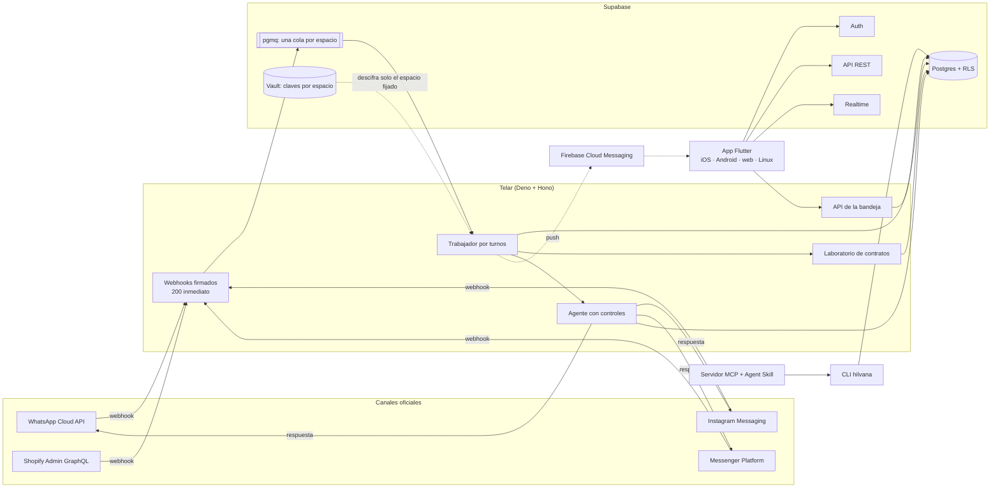

# Arquitectura

Hilvana es una base abierta y **local primero** para unir conversaciones de negocio que llegan por
canales oficiales. Cada negocio es un **espacio** aislado. Todo corre en una computadora con Docker
(`docker compose up --build`) y el mismo código se despliega en Google Cloud.

## Piezas



| Pieza | Carpeta | Responsabilidad |
|---|---|---|
| Núcleo | `supabase/` | Esquema, RLS, Vault, colas, roles y pruebas pgTAP. |
| Telar | `telar/src/` | Webhooks, cola, trabajador, respuestas, API de la bandeja, eliminación de cuenta, push. |
| Conectores (MIT) | `telar/connectors/` | Firmas, ventanas, parseo y envío de WhatsApp, Instagram, Messenger y Shopify. |
| Laboratorio | `lab/` | Anonimización, inferencia de esquemas, deriva con diff, reproducción y tipos TS/Dart. |
| Agente | `agent/` | Especificación (Zod), configurador por entrevista, recuperación, controles y evaluación. |
| SDK (MIT) | `sdk/` | Sobre interno de mensajes y tipos generados de los contratos. |
| App | `app/` | Bandeja Flutter con tema propio, tiempo real, respuesta, eliminación de cuenta. |
| CLI | `cli/` | `hilvana up/down/status/tunnel/space/connect/contracts/deploy`. |
| Habilidad y MCP | `skill/` | Agent Skill (`SKILL.md`) y servidor MCP de solo lectura por defecto. |
| Nube | `cloud/`, `telar/Dockerfile` | Cloud Build, Artifact Registry, Secret Manager y Cloud Run. |

## Flujo de un mensaje

```mermaid
sequenceDiagram
  autonumber
  participant M as Meta
  participant T as Telar (HTTP)
  participant Q as Cola del espacio (pgmq)
  participant W as Trabajador
  participant DB as Postgres (RLS)
  participant A as Agente
  M->>T: POST /webhooks/meta/{credencial} + X-Hub-Signature-256
  T->>DB: resolver credencial → espacio; descifrar App Secret (Vault)
  T->>T: HMAC-SHA256 sobre el cuerpo crudo
  T->>Q: encolar (y despertar el drenado en la nube con pg_net)
  T-->>M: 200 EVENT_RECEIVED (< 1 s)
  W->>Q: leer por turnos (cubeta de tokens del espacio)
  W->>DB: set local hilvana.workspace_id
  W->>DB: contacto, conversación y mensaje (único por id del canal)
  W->>DB: laboratorio: muestra anónima, esquema, deriva
  W->>A: respuesta propuesta por el modelo
  A->>A: controles: precios y productos del catálogo, inyección, fugas
  W->>DB: respuesta registrada (única por mensaje entrante) y ventana 24 h
  W->>M: envío por la API oficial (o pase a una persona)
```

## Aislamiento por capas

1. **Rutas**: cada app de Meta o tienda llega por una URL con el id de su credencial; la credencial
   pertenece a un solo espacio. El canal se valida contra esa credencial (no se confía en el cuerpo).
2. **Base de datos**: RLS en todas las tablas. Los miembros ven los espacios donde son miembros
   (`private.my_workspace_ids()`); el rol `hilvana_telar` no tiene `BYPASSRLS` y solo ve el espacio que
   fija con `set local hilvana.workspace_id`. Las llaves compuestas `(id, workspace_id)` impiden
   referencias cruzadas aunque el código tuviera un error.
3. **Claves**: Vault cifra el JSON de cada credencial; `private.telar_credential_secret()` solo descifra
   la del espacio fijado. Los registros se censuran por nombre de campo y por forma de valor.
4. **Recursos**: una cola pgmq por espacio y una cubeta de tokens por espacio (mensajes por minuto del
   plan), presupuesto diario de tokens de IA y tope de gasto mensual. Un espacio saturado espera en su
   propia cola (T-10).

## Modo local y modo nube

| | Local (`docker compose`) | Google Cloud |
|---|---|---|
| Base | `supabase/postgres` 17 con migraciones | Supabase gestionado (o autoalojado) |
| Auth / REST / Realtime | GoTrue, PostgREST, Realtime autoalojados | Supabase gestionado |
| Telar | contenedor `telar` | Cloud Run (escala a cero) |
| Trabajador | contenedor `worker` en bucle | `/internal/drain` despertado por `pg_net` al encolar + `pg_cron` cada minuto de respaldo |
| Secretos de la plataforma | `.env` (generado por `hilvana init`) | Secret Manager |
| Webhooks entrantes | `hilvana tunnel` (Cloudflare Quick Tunnel) | URL pública de Cloud Run |

## Decisiones y cómo defenderlas

| Decisión | Alternativa descartada | Por qué |
|---|---|---|
| Una cola pgmq por espacio y turnos rotativos | Una cola global | Con una cola global, 10 000 mensajes de un cliente retrasan al resto aunque se limiten; con colas separadas el aislamiento es estructural (T-10). |
| Rol propio del Telar sin `BYPASSRLS`, con espacio fijado por transacción | Conectarse como `service_role` | Un error de código no puede leer datos de otro espacio: la base lo impide. Defensa en profundidad. |
| Firma verificada sobre los bytes crudos antes de parsear | Verificar sobre el JSON re-serializado | Meta firma el cuerpo tal como lo envía (con unicode escapado); re-serializar rompe la firma o abre ataques. |
| Idempotencia en la base (índices únicos) | Caché en memoria de ids vistos | Sobrevive reinicios y varias instancias; Meta reintenta durante 36 h. |
| "No enviar dos veces" antes que "enviar siempre" | Reintentar envíos fallidos | La API de envío no tiene clave de idempotencia; un duplicado al cliente es peor que pasar el caso a una persona. |
| Controles deterministas alrededor del modelo | Confiar en el prompt | El prompt baja la probabilidad de error; los controles la llevan a cero para precios y productos (T-06). |
| Proveedor de IA vía API compatible con chat completions | SDK de un proveedor concreto | Cada espacio elige proveedor y clave, incluidos modelos locales; sin dependencia de un tercero. |
| Embeddings locales de 384 dimensiones (feature hashing) | Llamar a una API de embeddings | Funciona sin red ni claves; un modelo de 384 dimensiones puede reemplazarlo sin migrar la tabla. |
| Laboratorio con anonimización por lista blanca | Lista negra de campos sensibles | Lo desconocido se enmascara por defecto: un campo nuevo con datos personales no se filtra (T-08). |
| Deno con permisos explícitos y red acotada (`*.myshopify.com`, Graph API, base) | Node sin permisos | Si una dependencia se compromete, no puede salir a hosts arbitrarios ni leer el disco. |
| Supabase autoalojado en compose con las versiones de la CLI 3.1.0 | Depender solo de `supabase start` | `docker compose up --build` levanta todo, incluido en Windows donde el runtime nativo no existe. |
