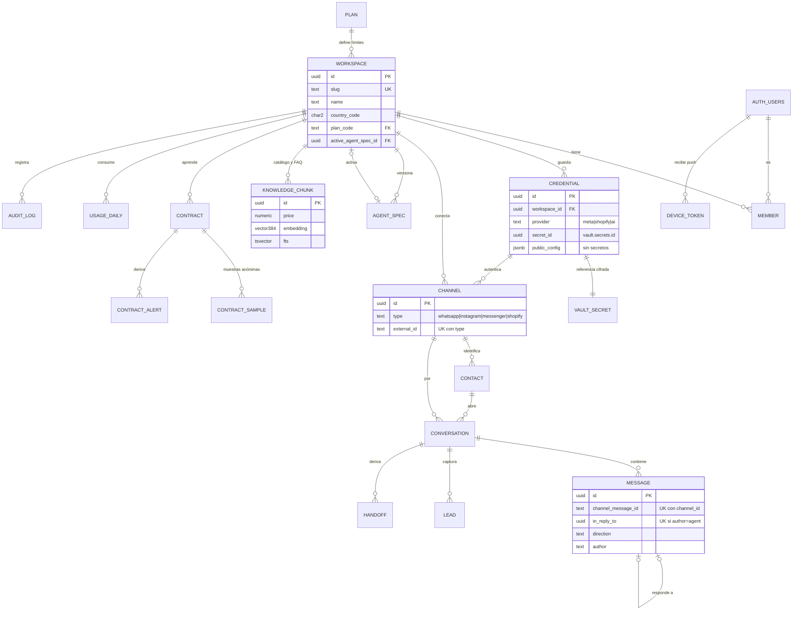

# Modelo de datos

Derivado de las fuentes en [investigacion.md](investigacion.md) (los números `#n` remiten a esa tabla).
Las migraciones viven en [`supabase/migrations/`](../supabase/migrations) y se aplican igual con la CLI de
Supabase (`supabase db reset`) que con el script de Docker (`scripts/db-migrate.sh`). Los nombres de tablas
y columnas están en inglés, como el resto del código.

| Plan original (español) | Tabla |
|---|---|
| espacio | `workspace` |
| miembro | `member` |
| credencial | `credential` (+ secreto en `vault.secrets`) |
| canal | `channel` |
| contacto | `contact` |
| conversacion | `conversation` |
| mensaje | `message` |
| agente_spec | `agent_spec` |
| fragmento | `knowledge_chunk` |
| lead / derivacion | `lead` / `handoff` |
| contrato / muestra | `contract` / `contract_sample` (+ `contract_alert` para la deriva) |
| uso | `usage_daily` |
| auditoria | `audit_log` |
| (nuevo) | `plan`, `device_token`, `private.rate_bucket`, `private.webhook_receipt` |

## Diagrama entidad-relación



## Tablas

Todas las tablas de `public` tienen **RLS activado**. Las funciones con privilegios elevados viven en el
esquema `private`, que PostgREST no expone (#6).

| Tabla | Campo | Tipo | Restricción | Regla / fuente |
|---|---|---|---|---|
| `plan` | `code` | text | PK, `^[a-z0-9_]{2,32}$` | Límites por espacio en datos, no en código. |
| | `messages_per_minute` | int | > 0 | T-10: un espacio saturado no frena a otros. |
| | `ai_tokens_per_day` | int | ≥ 0 | OWASP LLM10 consumo sin límite (#55). |
| | `monthly_spend_cap_usd` | numeric(10,2) | ≥ 0 | Gasto máximo por espacio. |
| | `retention_days` | int | 30–3650 | LOPDP art. 12 informa tiempo de conservación y art. 15.4 elimina al vencer (#50). |
| `workspace` | `id` | uuid | PK | Unidad de aislamiento. |
| | `slug` | text | único, `^[a-z0-9][a-z0-9-]{1,38}[a-z0-9]$` | Nombre corto para CLI y MCP. |
| | `name` | text | 2–120 caracteres | |
| | `country_code` | char(2) | ISO 3166-1 alfa-2 | Define ley aplicable (EC → LOPDP, PE → Ley 29733). |
| | `timezone` | text | zona IANA | Horarios del agente. |
| | `plan_code` | text | FK `plan` | |
| | `active_agent_spec_id` | uuid | FK `agent_spec`, nulo | Versión publicada en uso; volver atrás = apuntar a otra publicada. |
| `member` | (`workspace_id`, `user_id`) | uuid | PK compuesta; FK `auth.users` en cascada | Rol `owner` / `agent` / `viewer`; siempre queda al menos un `owner`. |
| `credential` | `secret_id` | uuid | único | Referencia a `vault.secrets`; el JSON secreto nunca vuelve al cliente (#4, T-04). |
| | `provider` | text | `meta` / `shopify` / `ai` | |
| | `public_config` | jsonb | sin claves | `appId`, `humanAgentApproved` (S-02), dominio de tienda, modelo de IA. |
| | `status`, `expires_at` | text, timestamptz | `active`/`expired`/`revoked` | |
| `channel` | (`type`, `external_id`) | text | único global | Enrutamiento por número, página, cuenta IG o tienda (#21, #28). |
| | `credential_id` | uuid | FK `credential` | El webhook solo se acepta si llegó por la credencial dueña del canal. |
| `contact` | (`channel_id`, `external_id`) | text | único | `wa_id`, PSID, IGSID o id de cliente de Shopify. |
| | `consent_marketing`, `consent_marketing_at`, `consent_source` | bool, timestamptz, text | | Consentimiento previo y expreso para promociones (#50, #52). |
| | `opted_out_at` | timestamptz | | Oposición a mercadotecnia directa en cualquier momento (LOPDP art. 16). |
| `conversation` | `status` | text | `agent` / `human` / `closed` | Solo una abierta por contacto (índice parcial único). |
| | `window_expires_at` | timestamptz | | Ventana de 24 h (#22, #27, #30). |
| | `human_window_expires_at` | timestamptz | | Ventana Human Agent de 7 días en Messenger/Instagram (#27, #30). |
| `message` | (`channel_id`, `channel_message_id`) | text | único parcial | T-02: un webhook repetido no crea otro mensaje (#21 pide deduplicar). |
| | `in_reply_to` | uuid | único parcial si `author = 'agent'` | T-02: una sola respuesta automática por mensaje entrante. |
| | `status` | text | `received`…`failed`, `blocked` | `blocked` = no se envió por ventana cerrada (T-07). |
| | `cost_usd` | numeric(10,6) | nulo | Solo si hay tarifa oficial cargada (S-01). |
| `agent_spec` | (`workspace_id`, `version`) | int | único | Borradores editables; publicadas inmutables (trigger). |
| | `spec` | jsonb | validado con Zod en `agent/` | Ver "Especificación del agente". |
| `knowledge_chunk` | `price`, `currency`, `stock` | numeric(12,2), char(3), int | ISO 4217 | Los precios del agente salen de aquí, nunca del modelo (T-06). |
| | `embedding` | vector(384) | índice HNSW coseno | pgvector; 384 dimensiones para modelos locales pequeños. |
| | `fts` | tsvector | generado, `spanish`, índice GIN | Búsqueda híbrida con el vector. |
| `lead` | `status` | text | `new`/`contacted`/`won`/`lost` | |
| `handoff` | `reason` | text | catálogo cerrado | Pase a humano con motivo auditable. |
| `contract` | (`workspace_id`, `event_key`, `version`) | | único | Esquema JSON inferido, `schema_hash` SHA-256 canónico. |
| `contract_sample` | `payload` | jsonb | anonimizado antes de guardar | T-08 (#25 prohíbe usar datos de la plataforma para entrenar modelos; aquí solo se infiere forma). |
| `contract_alert` | `changes` | jsonb | | T-09: diff legible entre versiones. |
| `usage_daily` | (`workspace_id`, `day`) | date | PK | Tokens de IA, mensajes y costos por día. |
| `audit_log` | `id` | bigint identity | | Quién cambió qué y cuándo (triggers). |
| `device_token` | `token` | text | único | Push con FCM; cada usuario ve solo los suyos. |
| `private.rate_bucket` | `workspace_id` | uuid | PK | Cubeta de tokens para mensajes por minuto (T-10). |
| `private.webhook_receipt` | (`provider`, `delivery_id`) | text | PK | Deduplicación de `X-Shopify-Webhook-Id` (#32). |

## Seguridad en la base

- **Miembros (`authenticated`)**: las políticas usan `workspace_id in (select private.my_workspace_ids(...))`,
  que se evalúa una vez por sentencia (#6). Escrituras sensibles solo por funciones RPC que validan el rol.
- **Telar (`hilvana_telar`)**: rol propio sin `BYPASSRLS`. Cada transacción fija
  `set local hilvana.workspace_id = '<uuid>'` y las políticas `telar_scope` solo dejan ver ese espacio.
  Las búsquedas que cruzan espacios (resolver la credencial de un webhook) son funciones `security definer`
  pequeñas que no devuelven datos de clientes.
- **Vault**: `public.store_credential()` cifra el JSON con `vault.create_secret()`; solo
  `private.telar_credential_secret()` lo descifra, y solo para el espacio fijado en la transacción.
  `anon` y `authenticated` no tienen acceso al esquema `vault`.
- **Colas**: una cola `pgmq` por espacio (`ws_<uuid sin guiones>`), operada solo con funciones `private.telar_*`.
  El trabajador recorre las colas por turnos y cada espacio consume su propia cubeta de tokens.
- **Realtime**: `conversation` y `message` están en la publicación `supabase_realtime`; RLS filtra cada
  cambio por suscriptor (#7).

## Formato interno de mensajes

Cada conector traduce el webhook de su canal a un sobre único (`telar/src/core/envelope.ts`):

```jsonc
{
  "v": 1,
  "channel": "whatsapp",              // whatsapp | instagram | messenger | shopify
  "kind": "message",                  // message | status | catalog | compliance | unknown
  "eventKey": "whatsapp.messages.text",
  "externalChannelId": "1234567890",  // phone_number_id, página, cuenta IG o tienda
  "occurredAt": "2026-11-16T15:04:05Z",
  "contact": { "externalId": "593990000001", "displayName": "Cliente" },
  "message": { "externalId": "wamid.X", "type": "text", "text": "Hola", "replyTo": null },
  "status": null,
  "catalog": null
}
```

## Especificación del agente (`agent_spec.spec`)

Esquema en `agent/src/spec.ts` (Zod 4, exportado a JSON Schema en `agent/schema/agent-spec.schema.json`):

| Sección | Campos | Para qué |
|---|---|---|
| `business` | `name`, `industry`, `country`, `timezone`, `currency`, `languages` | Contexto fijo del negocio. |
| `assistant` | `displayName`, `tone`, `greeting`, `disclosure` | Siempre se presenta como asistente automático del negocio (#25). |
| `hours` | `weekly[]` (`day`, `open`, `close`), `outsideHoursMessage` | Horario de atención. |
| `catalog` | `source` (`manual`/`shopify`), `allowPriceQuotes` | Precios solo desde `knowledge_chunk`. |
| `policies` | `topic`, `text` | Entregas, devoluciones, pagos. |
| `handoff` | `keywords[]`, `onComplaint`, `maxAgentTurns`, `message` | Cuándo pasar a una persona. |
| `leads` | `capture`, `fields[]` | Qué datos de interés guardar. |
| `limits` | `maxReplyChars` | Respuestas cortas y revisables. |
